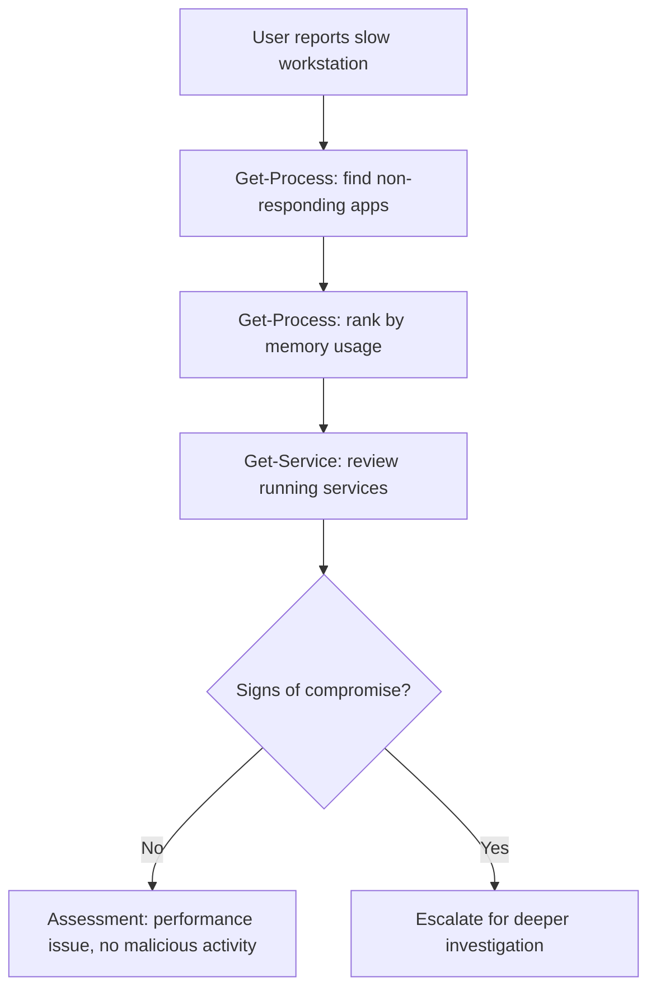

# 🛡️ Workstation Triage Investigation

    

---

## 📌 Executive Summary

**Core Technical Focus:**
Used `Get-Process` and `Get-Service` with property selection, filtering, and sorting to triage a workstation without making any changes to it.

**Defensive Impact:**
Gives an analyst a fast, read-only way to check whether a user's performance complaint is backed by evidence and to spot processes or services that need a closer look.

---

## 🎯 Objective & Challenge

*Determine whether a user's report of poor system performance is supported by evidence, and identify any processes or services that require further review.*

---

## 🔄 Investigation Workflow



---

## 🔐 Cybersecurity Context

Workstation triage is one of the first steps in incident response and troubleshooting. Before escalating, an analyst needs to know:

- Are any applications hung or unresponsive?
- What is consuming the most memory?
- Are core services running as expected?
- Is there anything unusual that points to compromise rather than a normal performance issue?

Doing this with read-only PowerShell commands preserves the system state while the evidence is collected.

---

## 🛠️ Implementation & Code

### Identify Non-Responsive Processes

```powershell
Get-Process |
Where-Object Responding -eq $false |
Select-Object ProcessName,
Id,
Responding
```

### Find Top Memory Consumers

```powershell
Get-Process |
Select-Object ProcessName,
Id,
WorkingSet64 |
Sort-Object WorkingSet64 -Descending |
Select-Object -First 10
```

### Review Running Services

```powershell
Get-Service |
Where-Object Status -eq 'Running' |
Select-Object Name,
Status |
Select-Object -First 10
```

---

### Investigation Findings

#### Non-Responding Processes

| Process Name | PID |
|-------------|------|
| SystemSettings | 24296 |

One non-responsive application was identified: the Windows Settings application.

#### Top Memory Consumers

| Process Name | PID | Working Set (Bytes) |
|-------------|------|-------------------:|
| Memory Compression | 3772 | 722,243,584 |
| [EDR agent – redacted] | 4908 | 718,573,568 |
| chrome | 16468 | 361,959,424 |
| Grammarly.Desktop | 14348 | 358,510,592 |
| msedgewebview2 | 18040 | 346,906,624 |

The highest memory consumers were Windows Memory Compression, the endpoint security (EDR) agent, Chrome, Grammarly Desktop, and Microsoft Edge WebView2.

#### Running Services Reviewed

| Service Name | Status |
|-------------|---------|
| Appinfo | Running |
| AppXSvc | Running |
| AudioEndpointBuilder | Running |
| Audiosrv | Running |
| [Privilege management service – redacted] | Running |

The reviewed services appeared healthy and operational.

### Analyst Assessment

The workstation appeared generally healthy.

One non-responsive process (`SystemSettings`) was identified, but on its own this does not indicate malicious activity. It is a standard Windows component and may have been temporarily unresponsive.

Windows Memory Compression and the EDR agent were the largest memory consumers. Both are expected system components and do not suggest suspicious behavior.

Core Windows and audio services were running normally. No unusual process names, service failures, or obvious indicators of compromise were observed.

The user's report of reduced performance is plausible; however, no indicators of malicious activity were identified during this initial triage.

---

## 🆕 New Command Introduced

### Where-Object

This project introduced the `Where-Object` cmdlet to address **finding the few relevant records in a full process or service list**.

Example:

```powershell
Get-Process |
Where-Object Responding -eq $false
```

### Why It Was Useful

`Get-Process` returns hundreds of objects. `Where-Object` reduced that to only the processes that were not responding, which turned a long list into a direct answer to the investigation question.

### Comparison

| Approach | Benefit | Limitation |
|-----------|-----------|-----------|
| Reading full `Get-Process` output | Shows everything | Easy to miss the one record that matters |
| `Where-Object` filter | Returns only matching objects | Requires knowing which property to filter on |

---

## ✅ Key Takeaways

- **Read-Only Triage:** Investigated a workstation using PowerShell without making any system changes.
- **Targeted Filtering:** Used `Where-Object` to isolate non-responsive applications.
- **Resource Analysis:** Ranked processes by memory consumption to explain performance complaints.
- **Evidence-Based Reporting:** Documented findings in an incident-style report rather than relying on assumptions.

---

## 🧠 Lessons Learned

This challenge brought together the core Cycle 1 skills (process enumeration, property selection, filtering, sorting, and service inspection) into one structured workflow. Instead of scrolling through raw output, each command answered a specific question, and the results built toward a clear assessment: the performance complaint was plausible, but there was no sign of compromise.

### New Concepts Integration

`Where-Object` was the key addition. It turns PowerShell from a tool that lists everything into one that answers questions, such as "which processes are not responding?" This filtering pattern is the foundation for every later investigation in this lab.
